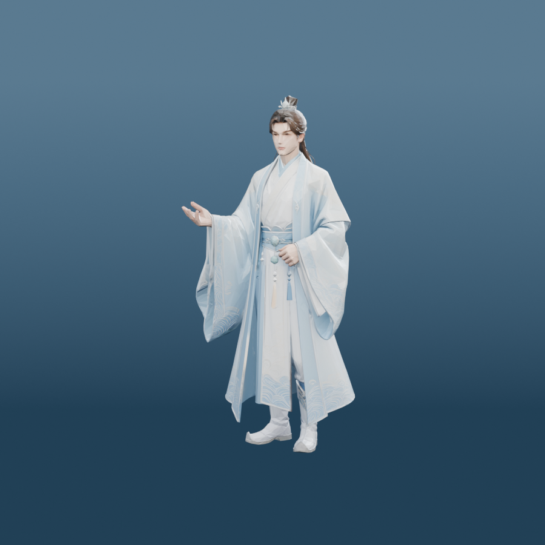

# 主人公 · Hero

3D 城（鲸城）玩家主人公的完整资产包。仙侠古风青年形象：深色长发+发冠、月白广袖长袍、腰间玉佩流苏、右手结印。



## 一、目录结构

```
assets/主人公/
├── README.md                ← 本文件
├── 原始素材/
│   └── hero.zip             ← ★ 扫描件（106 MB OBJ 149.9 万面 + 4K PBR 四贴图，无法线）
├── 设定图/
│   └── hero.png             ← 人设参考图（右下角"豆包AI生成"水印已擦除，2026-11-15）
├── model/
│   ├── hero_game.glb        ← ★ 游戏用资产（8.7 MB，贴图内嵌 2048 JPEG）
│   └── hero_diffuse_2k.jpg  ← 烘焙图集单独留份（改色/复用）
├── preview/
│   ├── hero.png             ← 主视觉（3/4 侧前）
│   ├── hero_front.png       ← 正视图
│   ├── views.png            ← 正/侧/背/顶四视图
│   └── animations.png       ← 6 套动画 × 3 帧拼版
└── scripts/
    └── build_hero.py        ← ★ 全流程脚本（Blender headless）
```

## 二、规格

| 项 | 值 |
|---|---|
| 网格 | 1 个蒙皮网格 `Hero`，44,957 三角面（46,691 顶点，meshopt 保缝减面） |
| 材质 | 1 个 `HeroMat`（原扫描贴图降采样 2048 JPEG，粗糙度 0.35，金属度 0；**背面剔除**） |
| 贴图 | 2048² JPEG 单张，**原 UV 直贴**（不做重展/反烘，脸部细节零损失） |
| 骨骼 | 17 根：`Root/Spine/Chest/Neck/Head` + 双臂三段 ×2 + 双腿三段 ×2 |
| 动画 | 6 个 clip，24 fps，随 glb 导出 |
| 尺寸 | 身高 1.0 单位，原点**脚底中心**，正面朝 −Y（glTF 里为 +Z） |
| 体积 | 8.7 MB |

## 三、动画 clip

| clip | 时长 | 循环 | 说明 |
|---|---|---|---|
| `Idle_Stand` | 4.0 s | ✅ | 呼吸起伏、重心微移、头部缓慢环视、袖摆 |
| `Loco_Walk` | 2.0 s | ✅ | 原地走：迈步、摆臂、袍摆（位移交给引擎） |
| `Loco_Run` | 1.4 s | ✅ | 原地跑：前倾、大步幅、快摆臂 |
| `Action_Jump` | 2.2 s | ❌ | 下蹲→蹬地腾空收腿→落地缓冲（带竖直 root motion） |
| `Action_Wave` | 1.7 s | ❌ | 右手抬起摆动打招呼，头部微歪 |
| `Action_Cast` | 2.5 s | ❌ | 施法：蓄力→推掌→收势（仙侠风，配特效更佳） |

单次动作播完自动回待机（前端 `LoopOnce + clampWhenFinished + finished 事件`）。

## 四、预览页

`work/hero-preview.html`（工作目录 `work/` 下，`python -m http.server` 后访问）：
六动作按钮栏、0.3–1.8× 倍速、自转开关（空格）、数字键 1-6 快切、地面接影。
three 0.169 已本地化到 `work/lib/three/`（GLTFLoader 需 BufferGeometryUtils）。

## 五、重新生成

```bash
# 1) meshopt 减面（保 UV 接缝，脸部不糊）——脚本在 .toolchains/hero-gltf-tools/
cd /f/blue-whale && npx obj2gltf -i work/hero/ref2/8264f36b...obj -o work/hero/hero-mid-raw.glb
node .toolchains/hero-gltf-tools/mid-simplify.cjs 0.03
# 2) Blender 全流程（绑定/动画/导出/渲染）
cd work/hero && HERO_DIR=/f/blue-whale/work/hero /d/blender/blender.exe -b --factory-startup -P build_hero.py
```

## 六、管线取舍与坑（复用前必读）

1. **不用 Blender Decimate**：塌缩会跨 UV 接缝焊接，头发 UV 糊到脸上；用 meshopt simplify（接缝当边界保护）。
2. **不重展 UV、不烘焙**：Smart UV 在脸部碎岛+串色；原 UV + 原贴图降采样最干净。
3. **不用 ARMATURE_AUTO**：在该扫描件上退化成单骨权重+千余零权重顶点；用平滑距离权重（反距离³、top-4）+ 每顶点保留 top-3 + 区域锁（袖子只归手臂骨、发髻只归头颈骨）。
4. **不做小壳刚性绑定**：meshopt 减面后连通壳多达 3,709 个，全绑到单骨会让角色碎裂飞散（小鲸宝只有 5 壳才适用那招）。
5. **动画 scale 键禁用乘法负值**：`1.01*cos(ph)` 半周期为负，three.js 负 scale 蒙皮矩阵会炸碎模型；用 `1 + 0.01*cos(ph)`。
6. **EEVEE 渲染**：关阴影（发丝/薄内衬投影条纹盖脸）+ 材质开背面剔除（对齐 three.js 单面渲染）。
