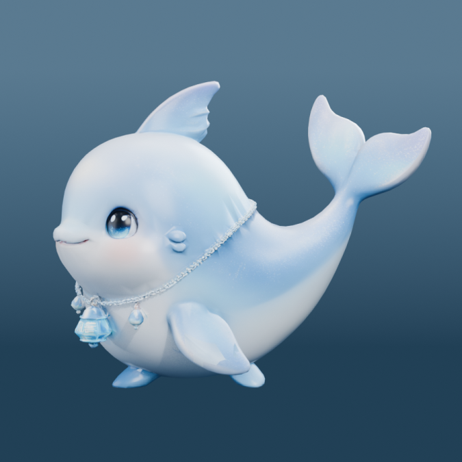

# 小鲸宝 · Little Whale Treasure

3D 城（鲸城）宠物角色的**完整资产包**：原始扫描件、模型、Blender 工程、贴图、生成脚本、预览图、可交互展示页，都在这个目录里。改完重跑脚本即可再生成。

形体来自你提供的扫描塑像（超大头身比、尾巴上卷、银链水晶铃铛、陶瓷釉面）；游戏用资产是单一蒙皮网格 + 单张烘焙图集 + 11 根骨骼 + 12 套动画。



## 一、目录结构

```
assets/小鲸宝/
├── README.md                    ← 本文件
├── 原始素材/                     ← 你提供的原始资料（只读，勿改）
│   ├── 小鲸宝.zip                ← ★ 当前模型所用扫描件（105 MB OBJ + 4K PBR 贴图）
│   └── 原始图/
│       └── 小鲸宝3D模型制作.png
│
> 注：主人公（仙侠人形角色）的素材已分家到 `assets/主人公/`，见该目录 README。
│
├── model/                       ← 成品模型
│   ├── xiaojingbao.glb          ← ★ 游戏用资产，贴图内嵌（2.9 MB）
│   ├── xiaojingbao.obj          ← 静态网格 15,632 面（DCC 交换用）
│   ├── xiaojingbao.mtl          ← OBJ 材质，贴图指向 ../model/atlas_diffuse.jpg
│   └── atlas_diffuse.jpg        ← 烘焙图集 2048²（单独留一份，便于改色/复用）
│
├── blend/                       ← Blender 工程
│   ├── xiaojingbao_pet.blend    ← ★ 主工程：骨骼 + 12 套 Action + 烘焙材质（2.2 MB）
│   └── xiaojingbao_render.blend ← 程序化建模版（高模渲染用，842 KB）
│
├── scripts/                     ← 生成脚本（Blender headless）
│   ├── build_pet.py             ← ★ 主脚本：扫描件 → 切底座 → 减面 → UV → 烘焙 → 绑定 → 动画 → 导出
│   ├── build_xiaojingbao.py     ← 程序化建模（从零造形，出高模渲染版）
│   └── render_anim.py           ← 开 blend 渲动作预览拼版
│
├── preview/                     ← 预览图
│   ├── hero.png                 ← 主视觉（3/4 侧前）
│   ├── hero_front.png           ← 正视图
│   ├── views.png                ← 正/侧/背/顶四视图
│   └── animations.png           ← 12 套动画 × 3 帧
│
└── showcase/                    ← 交互展示页（Three.js）
    ├── index.html               ← 构建产物：目录模式（需 http 访问）
    ├── app.bundle.js            ← 构建产物（588 KB）
    ├── build.py                 ← ★ 构建脚本
    └── src/
        ├── app.js               ← 相机、动画状态机、UI
        └── template.html        ← 结构与样式
```

> 3D 城里运行时用的那份 glb 放在 `whale-frontend/platform-apps/whale-world/src/assets/models/xiaojingbao/`，
> 是 `model/xiaojingbao.glb` 的副本（前端要就近引用）。换模型后两处都要更新：
> ```bash
> cp model/xiaojingbao.glb ../../whale-frontend/platform-apps/whale-world/src/assets/models/xiaojingbao/
> ```

## 二、规格

| 项 | 值 |
|---|---|
| 网格 | 1 个蒙皮网格 `WhalePet`，15,632 三角面（7,424 顶点，导出后因 UV/法线拆分 19,110） |
| 材质 | 1 个 `PetMat`（BaseColor 图集，粗糙度 0.30，金属度 0）；无透明、无自发光 |
| 贴图 | 2048² JPEG 单图集，内嵌在 glb 里 |
| 骨骼 | 11 根：`Root/Spine/Chest/Head/Tail1/Tail2/Fluke_L/Fluke_R/Pec_L/Pec_R/Bell` |
| 动画 | 12 个 clip，24 fps，随 glb 一起导出 |
| 尺寸 | 身高 1.0 单位（含尾鳍尖），左右跨度 1.13，前后 1.04 |
| 原点 | **脚底中心**（z=0 在最低点），可直接贴地或整体上抬做漂浮 |
| 朝向 | 模型正面朝 **−Y**（Blender 约定）；three.js 里要朝 +Z 需 `rotateY(Math.PI)` |

## 三、动画 clip（名称即 glTF clip 名）

| clip | 帧数 | 时长 | 循环 | 说明 |
|---|---|---|---|---|
| `Idle_Float` | 1–97 | 4.0 s | ✅ | 待机漂浮：上下浮沉、呼吸、尾巴轻摆、铃铛微晃 |
| `Idle_Sleep` | 1–97 | 4.0 s | ✅ | 睡觉：下沉、头微垂、尾慢摆，58–67 帧有一次睡梦小抖 |
| `Swim_Slow` | 1–57 | 2.3 s | ✅ | 慢游：柔和 S 形，胸鳍轻划 |
| `Swim_Fast` | 1–29 | 1.2 s | ✅ | 快游：尾部 22/30° 大幅摆，身体 S 形传导 |
| `Action_Happy` | 1–40 | 1.7 s | ❌ | 开心：下蹲 → 弹起 + 原地转一圈 |
| `Action_Snuggle` | 1–42 | 1.75 s | ❌ | 撒娇：前倾贴向主人、头部左右蹭 |
| `Action_Sad` | 1–58 | 2.4 s | ❌ | 委屈：缩小下沉、低头、尾鳍耷拉 |
| `Action_Heal` | 1–72 | 3.0 s | ❌ | 治愈：升起转一圈、胸鳍展开（星光粒子留给引擎） |
| `Action_Startle` | 1–29 | 1.2 s | ❌ | 受惊：猛缩 + 快速抖两下 + 恢复 |
| `Action_Follow` | 1–73 | 3.0 s | ✅ | 跟随：Root 偏航 0→360° 绕圈，途中探头偷看 |
| `Action_Appear` | 1–67 | 2.8 s | ❌ | 出场：从 −1.1 深处带旋升起、过冲落定 |
| `Action_Disappear` | 1–62 | 2.6 s | ❌ | 收回：边旋边沉出画面、同时缩到 0.55 |

含 root motion 的只有 `Action_Follow`（绕圈）、`Action_Appear` / `Action_Disappear`（上升/沉没）；
其余动作只在原地做姿态，位移交给引擎控制。

## 四、骨骼轴向备忘（改动画前必看）

动画脚本用「世界轴 → 骨骼局部」换算写入，所以改动画时按世界轴理解即可：

- **X 轴** = 俯仰（点头 / 后仰）
- **Y 轴** = 侧倾（左右翻滚）
- **Z 轴** = 偏航（原地转身）

Root 的位移同样是世界轴换算后写入的，`(0,0,dz)` 就是垂直上下，不受骨骼朝向影响。

## 五、接入提示

```ts
const gltf = await loader.loadAsync(url)
const pet = gltf.scene
pet.rotation.y = Math.PI                          // 正面 −Y → 朝 +Z
const mixer = new THREE.AnimationMixer(pet)
const clips = Object.fromEntries(gltf.animations.map(a => [a.name, a]))
mixer.clipAction(clips.Idle_Float).play()         // 循环
// 一次性动作：setLoop(THREE.LoopOnce, 1) + clampWhenFinished = true
```

- 图集 2048² 单张，建议开 mipmap；UV 岛之间留了 10 px padding，重采样不会串色。
- 铃铛 + 4 颗水晶吊坠是**独立壳**，整体刚性绑到 `Bell` 骨（权重 1.0），转身/低头时不会拉散，也不会穿过身体。
- 材质只有 BaseColor：水膜光晕、星光粒子、铃铛发光、拖尾这些特效由引擎侧做。
- 想要更"陶瓷"的手感，引擎里给材质加一点 clearcoat（≈0.3）和低粗糙度即可。
- **OBJ 是 Blender 坐标**（Z 向上、正面朝 −Y、原点在脚底），拖进 Unity/UE 要按各自约定转一次；
  OBJ 不含骨骼与动画，要动作用 glb 或 blend；材质走 `xiaojingbao.mtl`。

## 六、展示页（`showcase/`）

自动旋转 + 轨道控制 + 12 套动作演示。源码在 `showcase/src/`，构建脚本 `showcase/build.py`。

```bash
cd showcase
python build.py                             # 目录模式：index.html + app.bundle.js
python build.py --standalone ../单文件.html  # 单文件模式：GLB 以 base64 内嵌，双击即开
```

目录模式必须经 http 访问（`file://` 会被 CORS 拦住，读不到模型）：

```bash
cd ..                       # 回到 assets/小鲸宝/
python -m http.server 8000  # 浏览器打开 http://localhost:8000/showcase/index.html
```

页面上：自动旋转、自动轮播、单次动作循环、播放速度 0.3–1.8×、5 个视角预设（3/4 / 正 / 侧 / 背 / 俯）、12 个动作按钮。
快捷键 `空格` 暂停自转、`←/→` 换动作、`1–9` 快选；地址栏 `#Action_Heal` 可深链到某个动作。

依赖：esbuild + `three@0.169`（脚本会自动在 `whale-frontend` 的 node_modules 里找，也可用 `ESBUILD_BIN` 指定）。

## 七、重新生成

脚本以"工作目录"为根，里面要有 `ref2/`（解压后的扫描件）和 `out/`（产物），用 `XJB_DIR` 指过去：

```bash
export XJB_DIR=/f/blue-whale/work/xiaojingbao       # 该目录下有 ref2/ 与 out/
blender -b --factory-startup -P scripts/build_pet.py                # 全量：约 4 分钟（含 41 张预览渲染）
blender -b --factory-startup -P scripts/build_pet.py -- --norender  # 只出资产：约 45 秒
```

- 改体型：换 `原始素材/` 里的扫描件（解压到 `$XJB_DIR/ref2/`），或调 `build_pet.py` 的减面比例 / 烘焙分辨率。
- 改动作：改 `anim_*` 函数里的角度与帧数（按世界轴写）。
- 程序化版（不依赖扫描件）：`blender -b -P scripts/build_xiaojingbao.py`。

## 八、已知取舍

1. **形体直接来自扫描塑像**：底座（玻璃圆盘）已布尔切掉并封口，四只小脚保留（原设定件的一部分）。
2. **贴图带原件的烘焙高光**：扫描件的白色反光条已经画进 albedo，所以模型自带"釉面高光"。这是刻意的——它就是这个角色的观感；想做纯 PBR 需把高光抹掉重绘。
3. **没有法线贴图**：低模是同一曲面的减面结果，平滑着色足够；省一张贴图换体积。
4. **单条 UV 接缝在背脊**：背脊一条浅色细线是 UV 岛边界，近距离可见，正常视距无感。
5. **尾骨只有两段**（Tail1/Tail2），做不出连续波浪；要更柔软需加 2–3 段骨。
