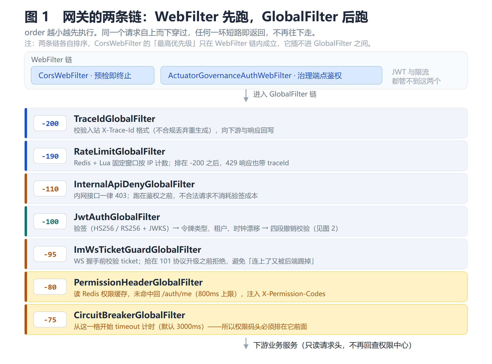
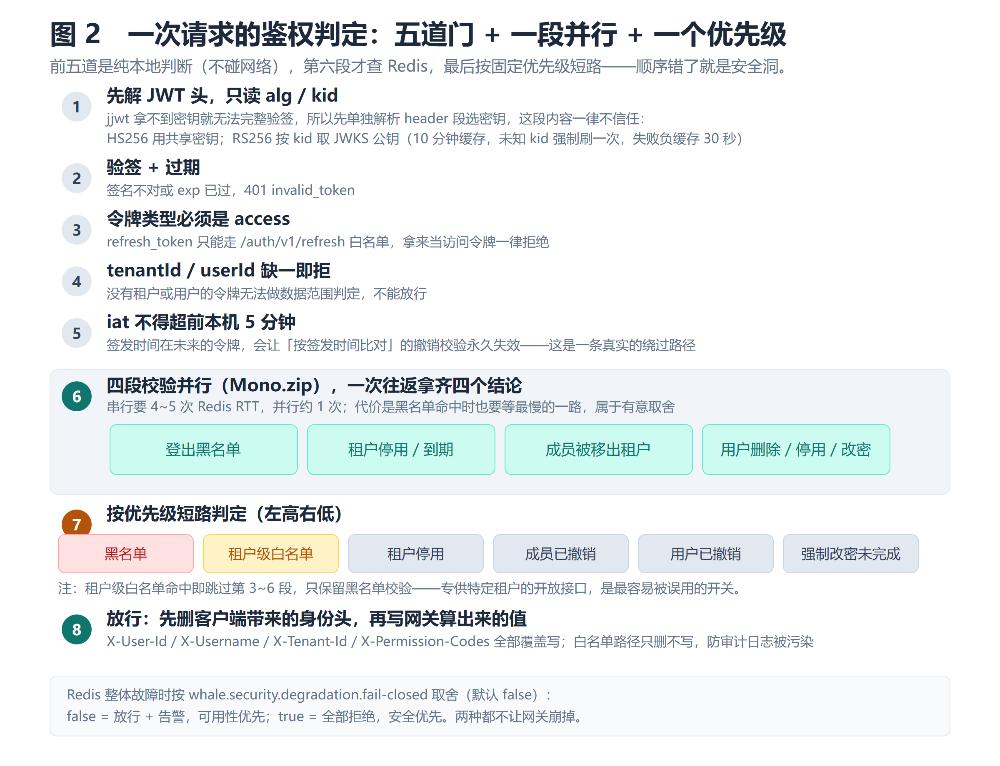
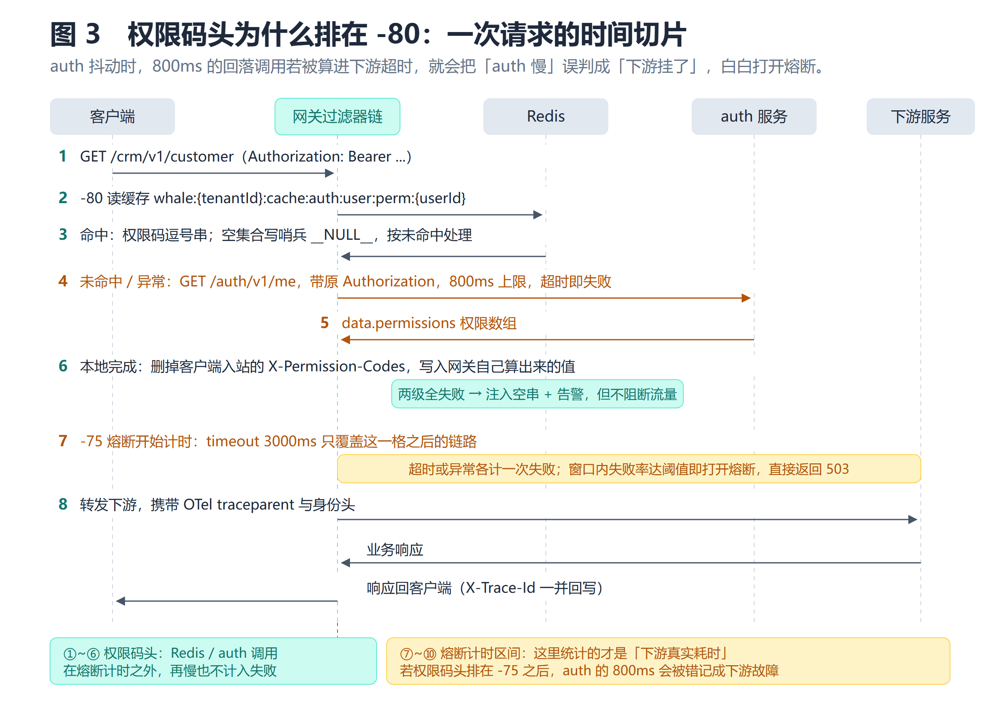

# 拆解蓝鲸·鲸喉：网关 80% 的代码都不在转发

> 系列第三篇。原本这一篇要拆权限中心，先插个队——网关刚被外部评审扫过一轮，坑还热着，趁热写。
> 先给结论：**网关难写的从来不是转发，是转发之外那 80%**。

顺着一条请求走一遍，会看到这么个场面：auth 抖了一下，单次响应 900ms。网关把这次回落算进了「下游调用耗时」，熔断器记下一次失败；窗口内失败率攒到阈值，熔断打开。下游 CRM 一点问题都没有，却替 auth 背了锅。

这篇就从这条链路说起。代码全部来自 `whale-service-gateway`（内部名「鲸喉」，取「一切流量必经之口」），Spring Cloud Gateway + WebFlux 响应式栈，20+ 个后端服务的唯一入口。

---

## 一、先看全景：两条链，七道关

很多人以为网关是「一排过滤器按顺序过一遍」。实际是**两条链**：WebFilter 链先跑，GlobalFilter 链后跑，各自排序。

`CorsWebFilter` 的「最高优先级」只在 WebFilter 链内成立——它插不进 GlobalFilter 之间。这点很重要：跨域预检必须在鉴权前结束，否则 OPTIONS 请求会先撞上 401，浏览器直接把跨域错误报给前端。

七道 GlobalFilter 的排位不是随心所欲，每一个 order 值背后都是一次线上问题：

| order | 过滤器 | 干什么 | 为什么必须是这个位置 |
|---|---|---|---|
| -200 | TraceIdGlobalFilter | 校验入站 `X-Trace-Id` 格式，向下游与响应回写 | 必须在最前，否则 429/403 这些「请求没进业务」的响应没有 traceId，排查时无从下手 |
| -190 | RateLimitGlobalFilter | Redis + Lua 固定窗口按 IP 计数 | 排在 TraceId 之后、鉴权之前：挡住刷量请求，别让它消耗验签与 Redis 查询 |
| -110 | InternalApiDenyGlobalFilter | 命中内网路径模式直接 403 | 排在鉴权之前：外部扫描 `/xxx/internal/**` 的请求，连验签都不该触发 |
| -100 | JwtAuthGlobalFilter | 验签 + 存量令牌治理 + 注入身份头 | 身份是一切判定的前提 |
| -95 | ImWsTicketGuardGlobalFilter | WS 握手前校验 ticket | 必须抢在 101 协议升级之前，见第六节 |
| -80 | PermissionHeaderGlobalFilter | 取权限码，注入 `X-Permission-Codes` | 必须排在熔断计时之外，这是本文第三节的主题 |
| -75 | CircuitBreakerGlobalFilter | Resilience4j 熔断，超时降级 503 | 最后一道：它的 `timeout` 覆盖其后所有链路，所以只该统计下游 |

一张表看完，其实能提炼出一条规律：**越靠前的过滤器越「便宜」且越「本地」，越靠后的越「贵」且越靠近下游**。TraceId 是纯字符串判断，限流一次 Redis，鉴权多次 Redis，熔断要等下游——把贵的往后放，短路时省下的成本才最多。

---

## 二、鉴权：五道本地门 + 一段并行 + 一个优先级

前五道全是本地判断，不碰网络：解 header、验签、查令牌类型、查租户与用户、查签发时间。任何一道不过就直接 401，一次 Redis 都不花。

第六段才查 Redis，而且**四段校验并行**：

| 校验层 | 拦什么 | 典型场景 |
|---|---|---|
| 登出黑名单 | 已登出的具体令牌 | 用户点「退出登录」，旧 token 立刻失效 |
| 租户状态 | 整个租户被停用或到期 | 客户欠费停服，全体成员立即失去访问 |
| 成员撤销 | 用户被移出某个租户 | 员工调岗，旧令牌不能再操作原租户数据 |
| 用户撤销 | 用户被删除/停用/改密 | 改密码后其它设备上的会话全部失效 |

JWT 天然的问题是一旦签发就无法撤回。这四层就是补丁——但补丁要打得便宜：串行执行是 4~5 次 Redis 往返，`Mono.zip` 并行后约 1 次。代价是黑名单命中时也要等最慢的那一路，这个取舍是刻意的：**九成九的请求是正常请求，为异常路径让所有正常请求多付 3 次 RTT 不划算。**

验签这一层有两个细节值得单说。

**其一，先解 JWT 头拿 `kid`，再去取公钥。** jjwt 必须拿到密钥才能完整解析令牌，而 RS256 的公钥要异步从 auth 的 JWKS 端点拉。这两个要求互相矛盾。解法是先单独解析 header 段——只读 `alg` 和 `kid`，这部分内容一律不信任，仅用于「选哪把钥匙」。密钥仓库 `JwksKeyStore` 做 10 分钟缓存，未知 `kid` 强制刷新一次（密钥轮换后新令牌立即可验，不用等 TTL 过期），拉取失败做 30 秒负缓存（auth 挂掉时不会被每个请求疯狂重试打成放大器）。

**其二，`iat` 必须校验。** 撤销校验大多靠「令牌签发时间 vs 撤销时间」比较，如果一个令牌的 `iat` 在未来，那无论用户怎么停用、改密、解绑，它永远「比撤销时间新」，四层校验全部免疫。这是一条真实的绕过路径，所以验签后加了 5 分钟时钟漂移上限——够容忍机器间的时间误差，不够容忍伪造。

最后一步是最容易被忽略的：**先删客户端带来的身份头，再写网关算出来的值**。`X-User-Id`、`X-Username`、`X-Tenant-Id` 这些头如果没有先删，攻击者直接在请求里带 `X-User-Id: 1`，下游服务全盘信任，整套 RBAC 形同不存在。免鉴权的白名单路径也一样删除，只是不写新值——否则审计日志会被伪造身份污染。

---

## 三、权限码头：一个 order 值，省掉一次误熔断

回到开头那个凌晨。

传统做法是每个微服务收到请求后自己调 auth 拿权限，auth 的 QPS 会被放大成「请求数 × 服务数」。鲸喉的做法是把这一步上移：网关取一次权限码，塞进 `X-Permission-Codes` 透传给下游，下游只读请求头。目前权限码总量 966 个，tenant_admin 视角实测 945 个（其余为平台专用）。这个体量如果每个服务、每次请求各拉一遍，auth 的 QPS 会被放大成「请求数 × 服务数」。

取权限码两级：先读 Redis（`whale:{tenantId}:cache:auth:user:perm:{userId}`，值为逗号串，空集合写哨兵 `__NULL__`），未命中或命中哨兵就回落到 `lb://whale-service-auth/auth/v1/me`，800ms 上限。

关键就在那个 800ms 和它所在的位置。

熔断过滤器 -75 的实现是 `chain.filter(exchange).timeout(3000ms)`——**它给其后所有链路套了一个 3 秒的秒表**。如果权限码头排在它后面，那么「800ms 回落 + 下游正常处理 800ms」这种组合，在 auth 抖动时很容易撞线，熔断器记一次失败，窗口内失败率累积到阈值，熔断打开。auth 的抖动就这样被记成了下游的故障。

排在 -80 之后，权限码头的耗时落在秒表之外，熔断器统计的就只剩真实的下游耗时。改一个整数值解决一个线上故障，这大概是整个网关里性价比最高的一行代码。

那如果两级都失败呢？注入**空串**并告警，不抛异常、不阻断流量。下游读 starter 里那个 `RequirePermissionInterceptor`（凡标了 `@RequiresPermission` 的服务都生效，不是某个模块专属），看到空权限就拒绝受保护接口。网关负责让请求过去，拒绝的动作交给真正懂业务语义的一方。

各处的降级策略不完全一样，这是有意的：

| 依赖故障 | 默认行为 | 开关 | 为什么这样取舍 |
|---|---|---|---|
| Redis（鉴权四段） | 放行 + 告警 | `whale.security.degradation.fail-closed`（默认 false） | 缓存故障不该让全站不可用；置 true 则安全优先，全部拒绝 |
| 权限码两级失败 | 注入空串 + 告警 | 无（固定） | 网关不阻断，下游按空权限拒绝受保护接口 |
| Redis（限流） | 直接放行 | 无 | 限流防的是滥用，不是越权，不该成为可用性单点 |
| 名单/路由覆盖拉取失败 | 保留内存旧快照 | 无 | 宁可用旧规则，也不能清空黑白名单 |

同一套系统里同时存在 fail-open 和 fail-closed，判断标准只有一条：**这条逻辑挂了，是「少了一道防护」还是「多了一次越权」**。前者可以放行，后者必须拒绝。

---

## 四、流量防护三件套

限流用 Redis + Lua 做固定窗口。Lua 的价值只在于原子性：`INCR` 和 `EXPIRE` 必须一次执行完，否则会出现「计数成功但过期没设上」的键，客户端从此被永久 429，而且极难排查。脚本里还额外加了 `TTL < 0` 兜底——`current == 1` 不足以判断是否需要补过期，脏键会让它永远补不上。

固定窗口有个众所周知的缺陷：窗口边界能过 2 倍突发。选它是因为计数成本最低、实现最简单，而我们要挡的是「单 IP 撞库」和「前端上报刷量」，不是精确的令牌桶限速。**知道自己放弃了什么，比宣称自己什么都做到了更重要。**

| 路径 | 默认阈值 | 目的 |
|---|---|---|
| 全局 | 200 次 / 秒 | 兜底，防单点打爆 |
| `/auth/v1/login` | 10 次 / 60 秒 | 防撞库：全局 200/s 对单 IP 等于不限 |
| `/auth/v1/refresh` | 20 次 / 60 秒 | 防刷新接口被当通道刷 |
| `/social/v1/login` | 10 次 / 60 秒 | 同上，第三方登录入口 |
| `/oauth2/token` | 60 次 / 60 秒 | 客户端凭据模式同样可被爆破 |
| `/audit/log/*/batch` | 30 次 / 秒 | 行为上报是公开写库接口，单独收紧 |

客户端识别默认信任 `X-Forwarded-For` 首段（`trust-forwarded-for=true`），前提是网关部署在 Nginx 之后、由 Nginx 覆写这个头。**如果网关直接暴露公网，必须显式设 `WHALE_GATEWAY_RATE_LIMIT_TRUST_XFF=false`**，否则攻击者自带一个 `X-Forwarded-For: 1.2.3.4` 就绕过了全部 IP 限流。这个默认值是给内网部署场景选的，现在启动时会打印一条告警提醒确认前提——照抄配置前请先确认自己属于哪种场景。

熔断只对配置里的路由生效，不是全量开启：

| 参数 | 默认值 | 说明 |
|---|---|---|
| `timeout-millis` | 3000 | 单次下游调用超时，超时即计失败 |
| `sliding-window-size` | 20 | COUNT_BASED 计数窗口，最近 20 次调用 |
| `failure-rate-threshold` | 50 | 失败率百分数 |
| 半开探测 | 1 次 | 只放一次探测，失败立刻重新打开 |
| `apply-to-routes` | auth / job / file / audit | 只有这些路由参与熔断 |

熔断状态变更时异步告警，上报跑在 `boundedElastic` 线程池——告警服务自己挂掉，绝不能反噬主链路。

内网接口防护是双防线：网关 `/*/internal/**`、`/*/*/internal/**` 两组 Ant 模式直接 403（还兼容 `discovery.locator` 带来的 `/whale-file/file/internal/**` 这种带服务名前缀的形态，剥掉一级路径段再匹配，防止绕过）；同时 default-filters 里 `RemoveRequestHeader=X-Internal-Token`，把外部请求携带的内网令牌头直接删掉，下游再校验一次。

---

## 五、动态路由：能力是动态的，现状是兜底的

路由定义存在 Nacos 的 `whale-gateway-routes.yaml`，网关自定义 `RouteDefinitionRepository` 读取。但真实情况是：**这份配置现在是空的，55 条路由全走 classpath 里的兜底文件**。

这不是没做完，是一个有意的选择。兜底文件保证 Nacos 挂了、配置解析出错、配置被误删时，网关不会整体瘫痪——它只是「少了动态能力」，不是「停止服务」。动态路由是能力，兜底是现状，两者都要有。

配置进门之前要过校验，规则比想象中严：

| 校验项 | 规则 | 为什么 |
|---|---|---|
| `uri` scheme | 仅 `lb` / `http` / `https` | 防下发任意协议 |
| predicate / filter 名称 | 白名单 | 防下发任意网关组件，白名单里刻意不含 `StripPrefix` |
| `Path` 断言 | 必须带一级前缀，禁 `/**` 裸匹配 | 防止一条路由吃掉全部流量 |
| `Path` 的 pattern 数量 | 只能一个 | Gateway 不按逗号切分 `args.patterns`，`/a/**,/b/**` 会被整串编译，该路由永不命中且不报错 |
| 路由 id | 同批唯一 | 运行时按 id 建映射，重复会冲突 |

任何一条非法，**整批拒绝、保留上一版**。这是配置类系统的通用原则：配置错误不应该被「部分应用」，那会让故障现场比故障本身更难判断。

治理端点 `/actuator/routeGovernance` 支持 POST 回滚到上一版路由快照。actuator 端点不走网关的 filter 链，所以它必须单独鉴权——`X-Governance-Token` 常量时间比较，令牌未配置时一律 403（fail-closed）。

路由还有一个业务属性覆盖层：启停状态、生效时间窗存在数据库里，网关定时拉快照，**只过滤掉不生效或被停用的路由，不改 predicate/filter**。好处是运维改路由开关不用碰 Nacos。数据库里配了、Nacos 里没有的 routeId 记为孤儿，打点告警而不是让网关报错。

---

## 六、黑白名单与 WebSocket

| 优先级 | 名单 | 命中结果 |
|---|---|---|
| 1 | 黑名单 | 403，高于一切 |
| 2 | 租户级白名单 | 跳过租户停用、成员撤销、用户撤销、强制改密校验，只保留登出黑名单 |
| 3 | 平台级白名单 | 免鉴权，但仍清身份头 |
| 4 | JWT 鉴权 | 正常流程 |

名单有两个来源：本地 yml + 定时从 auth 拉数据库快照，本地文件兜底，防止 auth 抖动时登录链路 401。另有一条 Nacos 热配置的应急黑名单（`emergency-blacklist`），不依赖 auth 可用性——auth 挂了也能立刻封禁危险接口，这是应急止血通道。拉取失败保留内存旧快照，定时任务带防重入标记，避免上一次 HTTP 还没回来就重复发起。

WebSocket 有个容易踩的坑：Spring Cloud Gateway 是先完成 HTTP 101 升级、再转发到后端。如果鉴权放在后端，攻击者会先拿到 101 响应，再被后端断开，前端看到的是「连上了又莫名断线」。`ImWsTicketGuardGlobalFilter` 在升级之前拦截 `/im/ws`、`/im/world`、`/doc/ws`，URL 里没有 `ticket` 参数就直接 401，不执行升级。

浏览器 WebSocket 握手带不了 `Authorization` 头，所以这三个路径都在 JWT 白名单里，改用一次性 ticket 鉴权。网关只判断参数存在性，**不消费票据**——票据有效期和一次性由 IM、doc 服务自己校验。职责分离，网关不碰业务语义。

---

## 七、异常与追踪：状态码别乱改

| 场景 | HTTP 状态 | 响应体 |
|---|---|---|
| 路由不存在 | 404 | `{code:404, message:"服务不可用"}` |
| 下游 502 / 503 / 504 | 原样保留 | `code` 同 HTTP 码 |
| 其它异常 | 500 | `{code:500, message:"系统异常"}` |
| 限流 | 429 | 带 `X-Trace-Id` |
| 内网接口 | 403 | 统一 JSON |
| 鉴权失败 | 401 | 统一 JSON |

下游的状态码不能被胡乱改写——把 503 回成 404，客户端的重试策略就错了。响应体里所有 message 都做 JSON 转义，防止 message 里混进引号或控制字符造成 JSON 注入。

追踪有两套并存：业务 `X-Trace-Id` 供日志 grep，W3C `traceparent` 供 OTel 链路可视化。入站 traceId 要过格式校验（`^[A-Za-z0-9_-]{1,64}$`），不合规直接丢弃重新生成，脏数据不能污染日志。网关内部用 WebClient 调 auth、调告警时手动注入 `traceparent`——手工创建的 WebClient 自动埋点传播不稳定，不显式写就会断链。

---

## 八、这一个月真踩到的三个坑

**一、JWKS 的惊群。** 密钥轮换后，一批携带新 `kid` 的请求同时到达，每个都发现「缓存里没有」，每个都触发强制刷新，auth 的 JWKS 端点瞬间被自己人打满。修复的思路不是加锁排队，而是给每次拉取编号：只有「晚于当前快照发起」的拉取才算新请求，其余 join 同一个 `Mono`。同时解决了另一个更隐蔽的问题——强制刷新时如果复用了「刚解析完的旧快照」，轮换后的新 `kid` 永远找不到。

**二、契约形状漂移，静默失效。** auth 的路由覆盖接口返回的是 `data[]` 数组，网关按 `data.items[]` 解析。结果：解析永远得到空集合，路由覆盖永远不生效，且没有任何报错。这类问题单测发现不了，只有跨服务契约测试能拦住。现在解析遇到未知形状会显式抛异常——**静默退化成「空」，比直接报错危险得多**。

**三、默认值的适用前提。** 限流信任 XFF 默认 true，是给「网关在 Nginx 之后」这个部署形态选的。一旦有人直连网关，这个默认值就从便利变成了漏洞。修法不是改默认值（内网场景改 false 会把所有用户折叠成同一个 IP，反而全局限流），而是在启动时把前提打印出来，逼部署侧确认。

三个坑的共同点：**没有一个会在编译或启动时报错**。这也是网关这类组件最费神的地方——它平时不出声，出声就是事故。

---

## 九、可以抄走的与别照抄的

可以抄：

1. 存量令牌治理：黑名单 + 租户状态 + 成员撤销 + 用户撤销，四层并行。
2. 权限码上移到网关，下游只读请求头。
3. 权限码头排在熔断计时之外——一个 order 值换掉一类误熔断。
4. 「先删后写」所有可信头，白名单路径只删不写。
5. 配置容灾三件套：本地兜底、非法整批拒绝、一键回滚。
6. WS 在协议升级前鉴权，票据校验留在业务侧。
7. 手工 WebClient 显式注入 `traceparent`，否则内网调用链路断头。

别照抄：

1. WebFlux 栈不能引 `spring-boot-starter-web`，公共组件里的常量得在网关内重定义一份——这是 Spring Cloud Gateway 的限制，不是设计缺陷，别为此去改公共模块的依赖。
2. 固定窗口限流只适合「防滥用」，需要精确限速就换令牌桶。
3. `/actuator/**` 不走网关 filter 链，别指望 JWT 能保护它，要么加治理令牌，要么在 Nginx 层只允许内网访问。

---

网关这个组件最反直觉的地方在于：正常请求走一遍，七个过滤器里六个只是读一下、判一下、写个头，看起来什么都没干。可一旦 auth 抖了、Redis 挂了、配置写错了、密钥轮换了，就是它们在兜。

系统叫蓝鲸（BlueWhale），技术栈 Spring Boot 4 + React 19 + qiankun。想聊私有化部署或想看我踩过的坑，评论区或私信。下一篇回到原计划：拆权限中心，讲它怎么从一个登录校验长成角色成长体系。

---

## 数字核对记录（内部，发布前可删）

| 口径 | 正文值 | 仓库出处 | 结果 |
|---|---|---|---|
| 过滤器 order | -200/-190/-110/-100/-95/-80/-75 | 各过滤器 `ORDER` 常量 | 一致 |
| JWKS 缓存 / 负缓存 | 10 分钟 / 30 秒 | `WhaleGatewayProperties#jwksCacheMinutes`=10、`JwksKeyStore#FAILURE_BACKOFF` | 一致 |
| 权限码回落超时 | 800ms | `PermissionHeaderProperties` | 一致 |
| 熔断超时 / 窗口 / 阈值 / 半开 | 3000ms / 20 次 / 50% / 1 次 | `CircuitBreakerProperties` | 一致 |
| 时钟漂移上限 | 5 分钟 | `JwtAuthGlobalFilter#ALLOWED_CLOCK_SKEW_MILLIS` | 一致 |
| 兜底路由 | 55 条 | `gateway-routes-fallback.yaml` 计数 | 一致（初稿写 49 为旧值，已改） |
| 后端服务数 | 20+ | `whale-services` 22 + `whale-apps` 11 | 标题原为「百万级微服务」，语义错位已改 |
| 权限码 | 966 / 实测 945 | `/auth/v1/me`、权限点统计 | 一致 |
| 网关测试 | 22 个测试类 / 190+ 测试方法 | `src/test` 计数（`@Test` 与 `@ParameterizedTest` 共 191 处） | 一致 |
| 公众号版差异 | 两张四列表改列表 | 过滤器 order、降级策略 | 手机端四列会挤成竖条，其余 5 张 3 列表原样保留；本文件保留表格，供知乎/掘金等平台直接复用 |
| 限流阈值 | 200/s、10/60s、20/60s、10/60s、60/60s、30/s | `application.yml#rate-limit.path-rules` | 一致 |
| 「生产打磨多年」 | 已删除 | 仓库首次提交 2026-10-16 | 原表述与事实不符 |

**封面素材**：`assets/d3/cover.png`（2.35:1，2160×920，后台「大图」）、`assets/d3/cover-square.png`（1:1，1000×1000，分享「小图」）。正文三图为 2400px 宽的 2 倍图，手机端点开可看清。
