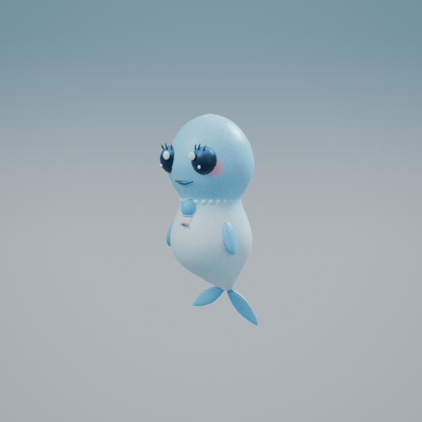

# 小鲸宝 · Little Whale Treasure（游戏版宠物资产）

3D 城（鲸城）宠物用低模资产。漂浮姿态 Q 版幼鲸，单一蒙皮网格 + 单张烘焙图集 + 11 根骨骼 + 12 套动画。
高模参考版（百万面级渲染资产）保留在个人工作目录 `work/xiaojingbao/`，不入库。



## 一、文件

| 文件 | 说明 |
|---|---|
| `xiaojingbao.glb` | 游戏用资产，贴图已内嵌（1.1 MB） |
| `atlas_diffuse.png` | 烘焙图集原图（1024×1024，单独留一份便于改色/二次利用） |
| `preview_hero.png` | 主视觉预览 |
| `preview_animations.png` | 12 套动画 × 3 帧预览 |

## 二、规格

| 项 | 值 |
|---|---|
| 网格 | 1 个蒙皮网格 `WhalePet`，5734 面 / 6514 四边面，导出 11236 三角面 |
| 材质 | 1 个 `M_XJB_Game`（BaseColor 图集 + 粗糙度 0.34），无透明、无发光 |
| 骨骼 | 11 根，`Root/Spine/Chest/Head/Tail1/Tail2/Fluke_L/Fluke_R/Pec_L/Pec_R/Bell` |
| 动画 | 12 个 clip，24 fps，全部带 fake_user，导出为 glTF animation |
| 尺寸 | 高 1.32 单位，头径 0.62；原点在身体中心（**不是脚底**），吊挂时需自行加偏移 |
| 朝向 | 模型正面朝 **−Y**（Blender 约定）；导入 three.js 后朝向 +Z 需 `rotateY(Math.PI)` |

## 三、动画 clip（名称即 glTF clip 名）

| clip | 帧数 | 时长 | 循环 | 说明 |
|---|---|---|---|---|
| `Idle_Float` | 1–97 | 4.0 s | ✅ | 待机漂浮：上下浮动、呼吸、尾巴轻摆、头环视 |
| `Idle_Sleep` | 1–97 | 4.0 s | ✅ | 睡觉：下沉少许、头微垂、尾巴慢摆，58–67 帧有一次小抖 |
| `Swim_Fast` | 1–29 | 1.2 s | ✅ | 快速游动：尾巴 24/32° 大幅摆，身体 S 形传导 |
| `Swim_Slow` | 1–63 | 2.6 s | ✅ | 慢游：柔和 S 形，胸鳍轻划 |
| `Action_Happy` | 1–40 | 1.7 s | ❌ | 开心跳：下蹲弹起 + 原地转一圈 |
| `Action_Sad` | 1–58 | 2.4 s | ❌ | 委屈：缩小下沉、低头、尾鳍耷拉 |
| `Action_Snuggle` | 1–42 | 1.75 s | ❌ | 撒娇：前倾 9° 贴向主人、头部左右蹭 |
| `Action_Heal` | 1–72 | 3.0 s | ❌ | 星光治愈：升起转一圈、胸鳍展开 |
| `Action_Startle` | 1–29 | 1.2 s | ❌ | 受惊：猛地一缩 + 快速抖两下 + 恢复 |
| `Action_Follow` | 1–73 | 3.0 s | ✅ | 跟随：Root 偏航 0→360° 绕圈，途中探头偷看 |
| `Action_Appear` | 1–67 | 2.8 s | ❌ | 出场：从 −1.1 深处带旋上升、过冲落定 |
| `Action_Disappear` | 1–62 | 2.6 s | ❌ | 收回：边旋边沉出画面、同时缩小到 0.55 |

含 root motion 的只有 `Action_Follow`（绕圈）、`Action_Appear` / `Action_Disappear`（上升/沉没）。
其余动作只在原地做姿态，位移交给引擎控制。

## 四、骨骼轴向备忘（改动画前必看）

竖直骨骼（Root/Spine/Chest/Head）：局部 X = 世界 X（俯仰/点头）、局部 Y = 世界 Z（偏航/转身）、局部 Z = 世界 −Y（侧倾）。
斜向骨骼（Tail1/Tail2）：局部 Z 是左右摆（摆尾用它），局部 X 是前后摆。

## 五、接入提示

```ts
// 伪代码
const gltf = await loader.loadAsync(url)
const pet = gltf.scene
pet.rotation.y = Math.PI                // 模型正面朝 -Y，转过来朝 +Z
const mixer = new THREE.AnimationMixer(pet)
const clips = Object.fromEntries(gltf.animations.map(a => [a.name, a]))
mixer.clipAction(clips.Idle_Float).play()
// 一次性动作：setLoop(THREE.LoopOnce) + clampWhenFinished
```

- 图集是 1024² 单张，建议开启 mipmap；UV 岛之间预留了 6 px padding，重度降采样时不会串色。
- 铃铛/珍珠/刻字都是刚体绑到 `Bell` / `Chest` 骨骼，不做二次形变，所以大幅扭腰时不会散开。
- 角色设定要求的水膜光晕、星光粒子、铃铛发光、拖尾等**特效不在模型里**，由引擎侧做（材质只有 BaseColor）。

## 六、已知取舍

1. **没有法线贴图**：低模与原高模轮廓一致，平滑着色已足够；省一张贴图换更小的体积。
2. **没有 SSS / 清漆**：高模的水润感靠 Subsurface + Coat，烘焙只保留 BaseColor，引擎侧可用 clearcoat 补一点高光。
3. **腮红是烘焙后按几何反算画进图集的**：Blender 5.2 的 Cycles 在烘焙求值时对腮红那段 Mix 节点恒返回 0（渐变能烘出来、腮红不能），因此改由脚本用同一公式在 UV 空间计算，结果与原材质一致。
4. 尾骨只有两段（Tail1/Tail2），做不出连续波浪传导；要更柔软需加 2–3 段骨。

## 七、重新生成

源脚本在 `work/xiaojingbao/`（不入库）：

```bash
blender -b --factory-startup -P build_game.py                # 低模 + UV + 烘焙 + 12 动画 + 导出
blender -b -P render_game_preview.py                         # 只重渲预览
```
